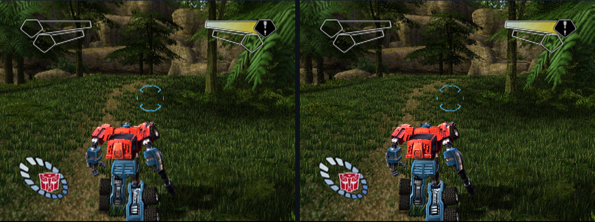
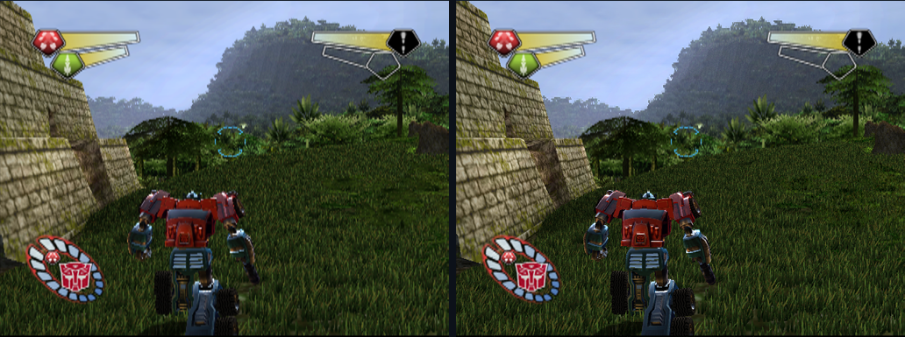
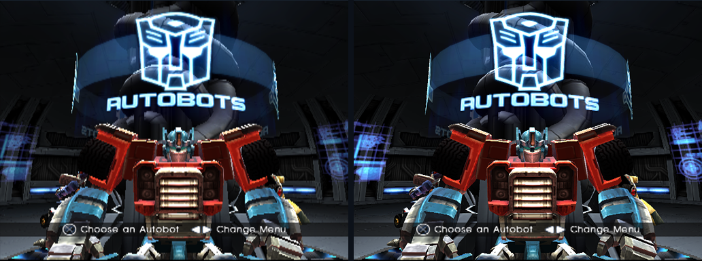
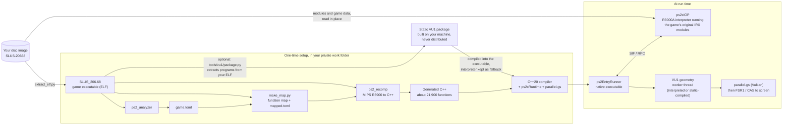

<div align="center">

# Transformers PS2 Port

**A native PC port of *Transformers* for PlayStation 2 (NTSC-U, SLUS-20668), made by statically recompiling the game's MIPS R5900 code into C++ with PS2Recomp.**

[](#requirements)
[](#requirements)
[](#building-and-running)
[](NOTICE/THIRD_PARTY.md)
[](#current-status)
[](LICENSE)

</div>

> [!IMPORTANT]
> **This repository contains no game files and no code generated from them.** There is no disc image, executable, IRX module, asset, generated C++, compiled VU1 package, save or memory card here. You need your own legally obtained copy of the NTSC-U disc (SLUS-20668). Setup reads it on your machine and keeps everything it extracts or generates in a private folder outside this repository.

For players: [setup](docs/SETUP.md), [build and resume](docs/BUILD.md), [controls](docs/CONTROLS.md), [troubleshooting](docs/TROUBLESHOOTING.md), [settings](docs/SETTINGS.md), [platforms / SteamOS](docs/PLATFORMS.md). Contributors: [environment contract](docs/OPTIONS.md), [decisions](docs/DECISIONS.md), [release checklist](docs/GO_PUBLIC.md).

**v0.8.3 release preparation:** this is a source checkout, requiring a compiler and your own supported disc image. Fresh-disc setup has passed the Windows scripted checks documented in testing/REFERENCES.md. See [Support](#support) for tested configurations; limited scripted checks do not establish whole-game qualification or a performance promise.

## New in v0.8.3

Faster EE checkpoints and RAM stores, corrected widescreen boss-gauge widget tracking, and default-off presentation diagnostics (`PS2X_PRESENT_TRACE=1`). Brief presentation stalls have been seen on one Linux handheld under Proton; the trace switch is available for investigation. The native renderer is not included. Setup now obtains and hash-checks the pinned SDK fingerprint database from upstream into private work; the database is not redistributed here.

## Contents

- [What is this?](#what-is-this)
- [Current status](#current-status)
- [Support](#support)
- [Screenshots](#screenshots)
- [Repository layout](#repository-layout)
- [Requirements](#requirements)
- [Building and running](#building-and-running)
- [How it works](#how-it-works)
- [Documentation](#documentation)
- [AI assistance](#ai-assistance)
- [Contributors](#contributors)
- [Credits and license](#credits-and-license)

## What is this?

An emulator interprets or translates a console's machine code while the game runs. Static recompilation does that work once, ahead of time: the game's executable is translated into C++ source, a normal compiler turns it into a native PC program, and a runtime stands in for the PS2 hardware (memory, DMA, vector units, graphics, sound and the I/O processor). This port recompiles the main (EE) CPU code with PS2Recomp, runs the game's own I/O processor modules on an interpreter, and draws through parallel-gs, a Vulkan compute implementation of the PS2 Graphics Synthesizer.

| Part | What it is | Where |
|---|---|---|
| Recompiler toolchain | `ps2_analyzer` finds functions and writes a TOML config; `ps2_recomp` translates R5900 code into C++ | `PS2Recomp/ps2xAnalyzer`, `PS2Recomp/ps2xRecomp` |
| Runtime | Memory, DMA/VIF, VU0/VU1 (VU1 on its own worker thread), GS front end, audio, controllers, presentation (FSR1/CAS, widescreen, 60 Hz fields), built-in timing | `PS2Recomp/ps2xRuntime` |
| IOP emulator | R3000A interpreter and virtual IOP kernel that run the game's original IRX modules, no BIOS needed | `PS2Recomp/ps2xIOP` |
| GPU renderer | parallel-gs with the Granite Vulkan framework | `deps/parallel-gs` |
| Setup and launchers | Disc image to a local game folder; play scripts and a play preset | `setup/`, `launch/` |
| Tests | Scripted input routes and exact reference counters | `testing/` |
| Tools | Game-data checker, function-map refiner, log comparer, VU disassembler, delay-slot audit | `tools/` |
| **You supply** | **Your own disc image** | outside this repository |

## Current status

**Experimental, v0.8.3 source.** Fresh-disc Windows setup and the limited scripted MVP and cinematic routes have passed, including counter checks, controlled state hashes and save persistence. This does not establish a complete campaign playthrough or qualification of every platform and graphics setting. Optional optimise is off by default and can take about 1.5 hours, depending on the system; it is separate from initial setup.

## Support

Bring your own legally obtained **NTSC-U disc, SLUS-20668**. Setup verifies your disc image and generates the required files locally; neither the game nor generated game code is supplied. See [setup](docs/SETUP.md) before starting.

| Platform or disc | Status | Scope |
|---|---|---|
| Windows 11 desktop, NVIDIA RTX 40 series | Tested | Limited setup and play coverage; not every model or driver |
| Windows 11 desktop, AMD RX 9070 class | Tested | Limited setup and play coverage |
| Linux handheld, Windows build under Proton, 15-35 W | Tested | Limited play coverage on one handheld; not native Linux qualification or a performance guarantee |
| NTSC-U disc, SLUS-20668 | Supported and tested | The only supported disc version; setup also checks the full image hash |
| PAL discs | Untested and unsupported | Different executables and regional behaviour are not qualified |
| macOS | Untested | No qualified build or launch path |
| Intel GPUs | Untested | No compatibility or performance claim |
| Other handhelds | Untested | Results from one handheld do not establish compatibility |

Known issues: brief presentation stalls have been seen on one Linux handheld under Proton. The trace knob `PS2X_PRESENT_TRACE` was added in a later build and is available in this v0.8.3 source. The experimental native high-resolution renderer is not included; this release uses parallel-gs. Limited route passes do not establish whole-game stability or complete visual/audio correctness.

For a reproducible gameplay problem, open an issue using **Bug report**. For disc verification, dependencies, generation, compilation or launch failures, use **Setup problem**. Include the release version, OS, GPU and driver, disc region, settings and exact steps. PAL reports can help document gaps, but PAL is unsupported.

Share only short, reviewed text excerpts: scripted tests write `stdout.log` and `stderr.log`; ordinary play launchers send output to the console and do not automatically create those files. A Windows crash may write `crash_YYYYMMDD_HHMMSS.txt` in the game working folder, or the directory selected by `PS2X_PLAYTEST_DIR` / `PS2X_DUMP_DIR`. If no log exists, say so and copy the visible error. Remove personal paths and network details, and omit guest memory or game-data content. Never upload disc images, game files, generated game code, saves, `crash_*.dmp`, `crash_*_rdram.bin` or other binary dumps.

## Screenshots

**Experimental native renderer**, left: the normal emulated picture (parallel-gs at the PS2's native resolution, enlarged); right: the experimental native renderer drawing the same frame at 2x internal resolution. Same scripted frame, same build. The native renderer is still experimental and is not in this source tree yet.


*Amazon forest: foliage, grass and Optimus Prime.*


*Ruined Temple: stonework and foliage.*


*Autobot hub: Optimus, emblem and menu.*

The images are scaled down for this page; the native renderer's extra detail shows best at full size on a high-resolution screen. Build-to-build comparisons (which are meant to look identical: every build must draw exactly the same picture) and more native previews are in [docs/NATIVE_RENDERER.md](docs/NATIVE_RENDERER.md).

## Repository layout

```text
.
├── PS2Recomp/                 PS2Recomp fork (GPL-3.0)
│   ├── ps2xAnalyzer/          finds functions in the ELF, writes the TOML config
│   ├── ps2xRecomp/            translates MIPS R5900 code into C++
│   ├── ps2xRuntime/           memory, DMA/VIF, VU0/VU1, GS front end, audio, pads, presentation
│   └── ps2xIOP/               R3000A interpreter that runs the game's own IRX modules
├── deps/
│   └── parallel-gs/           Vulkan compute GS renderer with Granite (LGPL-3.0 / MIT)
├── setup/
│   ├── setup.ps1, setup.sh    Windows and Linux wrappers (lower CPU priority)
│   ├── setup.py               disc image -> ELF -> analyse -> recompile -> build game folder
│   ├── extract_elf.py         reads only SLUS_206.68 from the ISO, without mounting it
│   └── vu1_aot.py             legacy entry point; use tools/vu1/package.py for the optional package
├── launch/
│   ├── play.ps1, play.sh      start a built game folder (play.sh also supports Proton)
│   └── play_env.txt           play preset: renderer, VU1 thread, audio, upscaling
├── testing/
│   ├── REFERENCES.md          accepted guest counters for the reference routes
│   ├── mvp/                   boot, hub, cinematic, warp-gate and Ruined Temple routes
│   ├── aotcov2/               forest, basin, temple and fresh-card routes; forest-route drafts in fv2dev/
│   └── event_scripts/         hub and warp-gate event routes
├── tools/
│   ├── check_no_game_data.py  fail-closed check for game data before committing
│   ├── make_map.py            refines the function map from a fresh analyzer run
│   ├── script_compare.py      compares the guest timelines of two scripted runs
│   ├── audit_delay_slots.py   checks the function map for branch delay-slot splits
│   └── vudis.py               VU micro-instruction disassembler
├── docs/                      setup, options, versions, performance, findings, images
├── NOTICE/                    third-party notices and licence texts
├── build_game_fast.bat        rebuilds the game executable in an external build folder
├── CONTRIBUTING.md
├── CREDITS.md
└── LICENSE                    GPL-3.0
```

## Requirements

- **Your disc:** an ISO9660 image (2048-byte sectors) of the NTSC-U disc, SLUS-20668. Raw 2352-byte images, compressed formats and other versions are not supported.
- **Git** is required on first setup to fetch the pinned SDK fingerprint database into private work, including when you downloaded a source snapshot. A verified matching private header can be reused offline. Git is also needed for the full contributor host test suite and staged-data checks; see [SDK database input](docs/SCE_DATABASE.md).
- **Python 3.11+** with `pyelftools` (`python -m pip install pyelftools`).
- **CMake 3.21+** and **Ninja**.
- **A C++20 compiler:** Visual Studio 2022 Build Tools on Windows (run setup from an x64 developer shell).
- **Vulkan:** the Vulkan SDK and a Vulkan-capable GPU, for parallel-gs.
- **Linux only:** FFmpeg development libraries visible to pkg-config (libavcodec, libavformat, libavutil, libswresample, libswscale) and raylib's desktop dependencies.
- **Network on first configure:** CMake fetches raylib, toml11, fmt and other dependencies, and on Windows an LGPL FFmpeg prebuilt. For offline builds, supply `FETCHCONTENT_SOURCE_DIR_*` caches (and `FFMPEG_PREBUILT_URL` pointing at a local zip on Windows).
- **Disk:** the checked-out files take about 131 MB (110 MB of it `deps/parallel-gs`), plus Git history. Your work folder holds the ELF, two generated C++ trees of about 22,000 files each (`output/` and `mapped-output/`) and two build trees; its size and the build time have not been measured yet.

## Building and running

> [!WARNING]
> Setup builds an **experimental** game folder. The default uses interpreted VU1; the optional FAST workflow generates a static package from your disc. Windows fresh-card MVP and cinematic routes are qualified separately from whole-game, visual/audio and Proton playtesting. See [docs/VU1_AOT.md](docs/VU1_AOT.md).

1. **Install the requirements** above, including `pyelftools`.
2. **Choose a private work folder outside this repository.** Use an absolute path and keep the source checkout separate from generated/build products. Setup refuses a folder inside the repository. Repeat the same command to resume an interrupted setup; see docs/SETUP.md for generation verification and retained attempts.
3. **Run setup.**

   Windows, from an x64 Visual Studio developer shell:

   ```powershell
   powershell -ExecutionPolicy Bypass -File setup/setup.ps1 -Iso "<absolute-iso-path>" -Work "<absolute-private-work-folder>"
   ```

   Linux:

   ```bash
   bash setup/setup.sh /path/to/Transformers.iso /path/to/transformers-local
   ```

   Both wrappers run `setup/setup.py`. To pass extra CMake options, call it directly: `python setup/setup.py --iso <iso> --work <work> --cmake-arg=-DNAME=VALUE` (repeatable).
4. **What setup does,** all inside the work folder:
   1. extracts `SLUS_206.68` and the nine private IOP boot files, and generates a scripted-route ISO map;
   2. builds `ps2_analyzer` and `ps2_recomp` in `build-tools/` (RelWithDebInfo, 4 parallel jobs);
   3. analyses the ELF into `game.toml` and recompiles it into `output/`;
   4. refines the function map with `tools/make_map.py` (`functions.csv`, `mapped.toml`) and recompiles into `mapped-output/`;
   5. builds `ps2EntryRunner` in `build-game/` with parallel-gs on; the optional fast path compiles a static VU1 package from your disc (see [docs/VU1_AOT.md](docs/VU1_AOT.md));
   6. copies the executable (and DLLs on Windows) to `game/`, with a `disc.json` that points at your ISO and ELF.
5. **Play.** Use the actual game folder printed by setup: `<work>/generation-<id>/game`. The selected id is also recorded in `<work>/setup-state.json`; replace `<id>` below with it.

   ```powershell
   # Windows
   powershell -ExecutionPolicy Bypass -File launch/play.ps1 -GameFolder "<work>/generation-<id>/game"
   ```

   ```bash
   # Linux, native build
   bash launch/play.sh /path/to/transformers-local/generation-<id>/game

   # Linux, Windows build under Proton (disc.json must hold the Linux paths of your ISO and ELF)
   PROTON=/path/to/proton STEAM_COMPAT_DATA_PATH=/path/to/private-prefix bash launch/play.sh /path/to/game
   ```

   The launchers load `launch/play_env.txt`, enable static VU1 when setup built that package, and read remaining game assets from your ISO. Saves persist at `<work>/saves/mc0` across setup generations, with five rotating backups before play. Keep the private IOP boot files beside the ELF in their disc directory layout. Edit the preset to customise; every setting is listed in [docs/OPTIONS.md](docs/OPTIONS.md). Keys: **F7** controller test, **F9** cycle sharpening, **F11** speed overlay, **F12** bug mark and screenshot, **F1** settings menu.
6. **After changing runtime code,** rebuild with setup again with the same arguments. It verifies source dependencies, selects a new generation when needed and refreshes the deployed game folder. Do not bypass its manifest checks.
7. **Before committing or opening a pull request,** run `python tools/check_no_game_data.py .` It rejects disc data, generated game code, build products and known private packages. It does not replace a human provenance review.

To build only the runtime library, without a disc:

```bash
cmake -S PS2Recomp -B /path/to/private-build -G Ninja -DPS2X_BUILD_RECOMP=OFF -DPS2X_BUILD_ANALYZER=OFF -DPS2X_BUILD_RUNNER=OFF
cmake --build /path/to/private-build --target ps2_runtime --parallel 4
```


### Optional: optimise for this PC, ~1.5 h (Windows/MSVC)

Add **`--optimise`** to `python setup/setup.py --iso <iso> --work <work>` in an x64 VS developer shell. Setup generates the FAST static-VU1 package from your own disc automatically for this option. If you already supply an external FAST package with CMake arguments, keep the same arguments. In the PowerShell wrapper use `-Optimise`; extra CMake options require the Python command. This option currently supports Windows/MSVC only; run the resulting Windows build through Proton if desired.

The ordinary build remains the default. Local optimisation uses MSVC fast profiling with 64-bit counters, builds an instrumented executable at four jobs, quietly trains from new empty cards using `testing/pgo/`, explicitly collects and merges your machine's profile, then relinks and checks the boot/new-game smoke plus exact first-level and cinematic counters. Generated EE translation units compile normally and reuse the ordinary build cache; runtime, IOP, static VU1 and the GS backend retain PGO. Short training slices include attract playback, menus, new-game cutscenes and first-level movement, firing and vehicle inputs. It never opens your gameplay card. No saved-game seeds, generated code or profiles ship with these routes.

The laptop rehearsal took **89.3 additional minutes** for the instrumented build, training, profile link and checks, reusing the ordinary build cache. Reserve **90 minutes and 25 GiB of free disk** for local optimisation, depending on CPU, compiler and disc storage; the private `optimise/state.json` records actual elapsed time and bytes. A link waits for **12 GiB of available physical RAM**, within a 16-hour overall expiry. These are planning allowances pending broader hardware measurements. Builds and tests run at BelowNormal priority with a hidden, silent game window. Avoid running another build at the same time.

Repeat the same command after interruption: completed instrumented builds and validated route profiles resume only for matching sources, generated code and compiler. An incomplete merge restarts from its unmerged database. Failed verification leaves the ordinary executable available in `game/fallback/ps2EntryRunner.exe`; copy it back to `game/ps2EntryRunner.exe` to restore it. The playable executable is replaced only after every optimisation check passes. Keep the entire private work directory on this machine; do not distribute its profiles or generated files. No speed benefit or parity with a campaign-trained profile is claimed until handheld testing.


## How it works



- **EE code** is translated once into C++ and compiled. The function map matters: `tools/make_map.py` adds the static constructors and indirect targets the stock analyzer misses, and removes branch delay-slot splits.
- **The IOP** (the PS2's I/O processor) is not recompiled. Its sound and disc-streaming modules are the game's own IRX files, run on an R3000A interpreter; a few generic services, such as the memory card server, are emulated at a high level.
- **Graphics** go through parallel-gs, which aims for software-renderer accuracy at GPU speed. FSR1 upscaling and sharpening run on the finished picture.
- **How the game reaches 60 fps:** the engine ticks its logic and physics 30 times a second, but renders 60 interlaced fields per second: each field is drawn separately, and the engine's own camera interpolation (a blend between the previous and current camera) supplies the in-between view. On a TV those fields are interlaced; with the 60 Hz option (`PS2X_FIELD60`, on by default) the port presents every field as a full frame, so you get 60 distinct frames per second without changing the game's timing.
- **VU1 geometry programs** run on a worker thread. Default setup uses the interpreter. The optional FAST workflow in [docs/VU1_AOT.md](docs/VU1_AOT.md) generates and compiles a static package from your own ELF, with interpreter fallback. Generated programs and packages stay in your private work folder. Fresh-card route counters and controlled state hashes qualify the tested paths; they do not establish whole-game coverage.
- **Testing** uses scripted input routes (`.tfs` files). A change is accepted only if guest counters (vsyncs, pad reads, cycles, CD reads, interrupts, VU1 calls) match the references exactly. Timing claims need repeated runs on a quiet machine.

## Documentation

| Document | Covers |
|---|---|
| [docs/SETUP.md](docs/SETUP.md) | Bring-your-own-disc setup and the current qualification gap |
| [docs/BUILD.md](docs/BUILD.md) | Requirements, offline caches, generation paths and resume |
| [docs/CONTROLS.md](docs/CONTROLS.md) | Controller, keyboard and host shortcuts |
| [docs/TROUBLESHOOTING.md](docs/TROUBLESHOOTING.md) | Setup and first-launch failures; safe bug reports |
| [docs/SETTINGS.md](docs/SETTINGS.md) | Settings menu, settings.ini, environment precedence and profiles |
| [docs/GO_PUBLIC.md](docs/GO_PUBLIC.md) | First-public-release evidence and blockers |
| [docs/OPTIONS.md](docs/OPTIONS.md) | Environment variables, keys and the play preset |
| [docs/VERSIONS.md](docs/VERSIONS.md) | Version history and v0.8 integration status |
| [docs/PERFORMANCE.md](docs/PERFORMANCE.md) | Measured fps, power and load times, and how they were measured |
| [docs/FINDINGS.md](docs/FINDINGS.md) | What made the port faster, and approaches that were rejected |
| [docs/findings/](docs/findings/README.md) | Bug-by-bug notes for other PS2 ports: runtime bugs, performance lessons, platform notes, widescreen/HUD, testing method, open issues |
| [docs/NATIVE_RENDERER.md](docs/NATIVE_RENDERER.md) | Experimental native renderer: costs, known differences, comparison gallery |
| [docs/VU1_AOT.md](docs/VU1_AOT.md) | Optional VU1 acceleration, and why no package ships |
| [docs/TESTING.md](docs/TESTING.md) | Repeatable scripted testing and timing rules |
| [docs/AGENT_HANDOFF.md](docs/AGENT_HANDOFF.md) | Orientation for contributors and their AI agents |
| [testing/REFERENCES.md](testing/REFERENCES.md) | Accepted guest counters for the reference routes |
| [CONTRIBUTING.md](CONTRIBUTING.md) | Pull request rules |
| [CREDITS.md](CREDITS.md), [NOTICE/THIRD_PARTY.md](NOTICE/THIRD_PARTY.md) | Provenance, attribution and licences |

## AI assistance

This port is built openly with AI assistance: Claude, Codex and Gemini helped with analysis, implementation and testing, under a human maintainer who sets priorities and play-tests the builds. The PS2Recomp community has norms against AI-assisted contributions, so we do not send pull requests upstream. Everything here stays available under GPL-3.0 for anyone who wants to study or reuse it.

## Contributors

| Who | Role |
|---|---|
| Project owner | Direction, priorities, play-testing on desktop and handheld |
| **Claude** (Anthropic) | Lead AI agent: coordination, investigation and diagnosis, integration, test design and analysis, documentation. Co-author of the commits in this repository |
| **Codex** (OpenAI) | AI coding agent: implementation, builds and exact-counter gate runs |
| **Gemini** (Google) | AI agent: research, reviews and side projects |

## Credits and license

This port stands on the work of the projects below. Full file-level attribution is in [CREDITS.md](CREDITS.md).

| Project | Used for | Licence |
|---|---|---|
| PS2Recomp | Base analyzer, recompiler and EE/IOP runtime, plus fixes from upstream pull requests | GPL-3.0 |
| [parallel-gs](https://github.com/Arntzen-Software/parallel-gs) and Granite | Vulkan GS renderer | LGPL-3.0-or-later; MIT |
| [PCSX2](https://github.com/PCSX2/pcsx2) | VU/VIF/GS semantics reference and adapted portions | GPL-3.0-or-later |
| rac1-native-game | Research inspiration for resumable setup and generation freshness | MIT |
| ps2-port-engine | Research inspiration for player documentation/setup UX | MIT |
| God of War recomp | VU1, EE/VU0, IOP and recompiler fixes | GPL-3.0 |
| socom-unzipped | VU1 fast path, XGKICK handling, VBlank latch | GPL-3.0 |
| PS2Recomp performance fork | Ordered presentation snapshot, VU1 EFU opcodes | GPL-3.0 |
| Shadow of the Colossus PS2Recomp fork | FPU/VU0 clamping, address masking, branch fixes | GPL-3.0 |
| Other PS2Recomp forks and pull requests, including PR #270 | Guest-branch unwind tracking, VU0 VCALLMS run-to-end fixes | GPL-3.0 |
| [AMD FidelityFX FSR1 and CAS](https://github.com/GPUOpen-Effects/FidelityFX-FSR) | Upscaling and sharpening | MIT |
| raylib | Window, input and audio backend | zlib |
| Dear ImGui and [rlImGui](https://github.com/raylib-extras/rlImGui) | Optional debug panel | MIT; zlib |
| [SDL2](https://github.com/libsdl-org/SDL) | Optional platform dependency | zlib |
| [FFmpeg](https://ffmpeg.org) | Movie (MPEG) decoding | LGPL-2.1-or-later |
| ELFIO, toml11, fmt, Rabbitizer, nlohmann JSON, libdwarf | Analyzer and recompiler dependencies | MIT; libdwarf LGPL-2.1-or-later or BSD |

We also learned from N64Recomp, Zelda64Recomp, XenonRecomp, UnleashedRecomp, Ship of Harkinian, OpenGOAL, Dolphin, RPCS3 and Xenia; no code from them is claimed. Local setup obtains the pinned sce-symbol-scanner SDK signature database inherited from PS2Recomp and embeds it only in your private analyzer (signature metadata, no game code). The database is not redistributed here; its licence is listed as unresolved in [NOTICE/THIRD_PARTY.md](NOTICE/THIRD_PARTY.md).

**License.** This port's own code is released under the [GNU General Public License v3.0](LICENSE). Bundled and fetched dependencies keep their own licences; see [NOTICE/THIRD_PARTY.md](NOTICE/THIRD_PARTY.md). Anyone redistributing binaries must meet those licences, including the LGPL terms for parallel-gs and FFmpeg.

**Trademarks.** *Transformers* belongs to its respective rights holders, and PlayStation 2 is a trademark of Sony Interactive Entertainment. This is an independent project, not affiliated with or endorsed by any of them, and it distributes no game content.

Host checks for a source snapshot without Git:

```sh
python -B testing/test_release_prep.py GenerationTests
python -B testing/test_launch_and_gates.py
python -B tools/check_no_game_data.py .
```

With Git installed, also run the full `testing/test_release_prep.py` suite and `tools/check_staged.py` before committing. Keep original third-party copyright and author notices under NOTICE and dependency source files.
