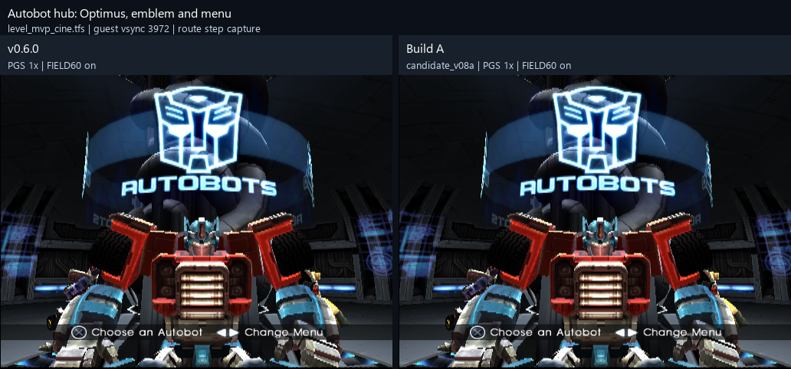
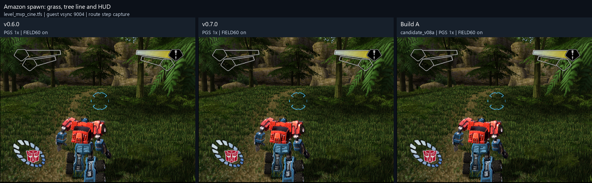
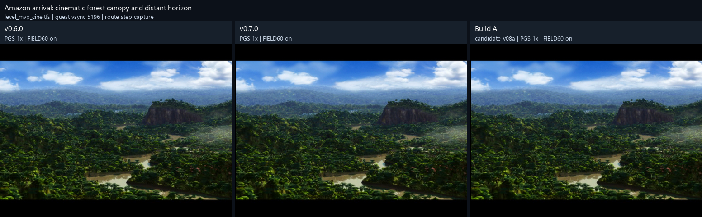
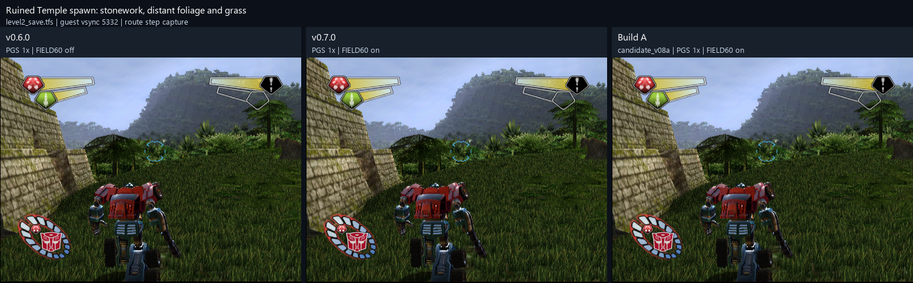
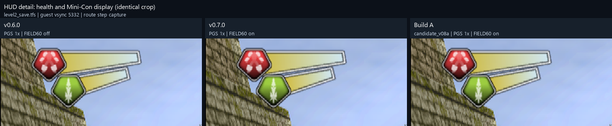
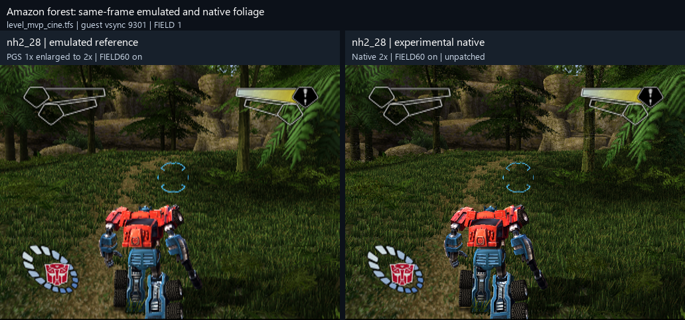
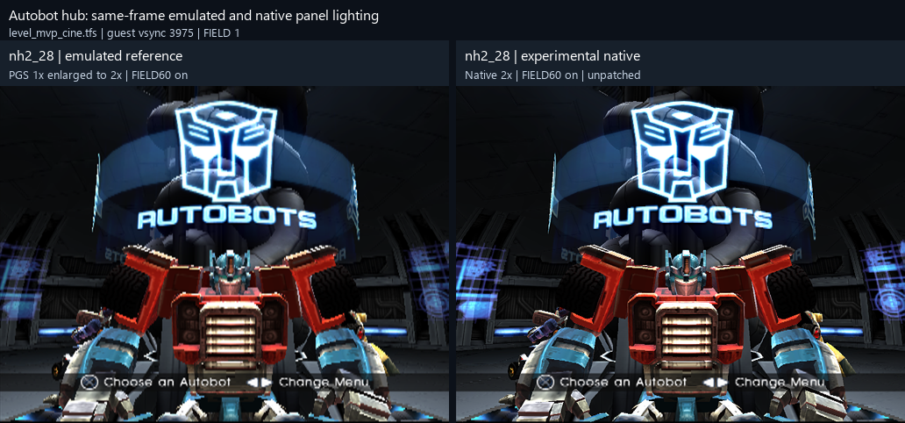
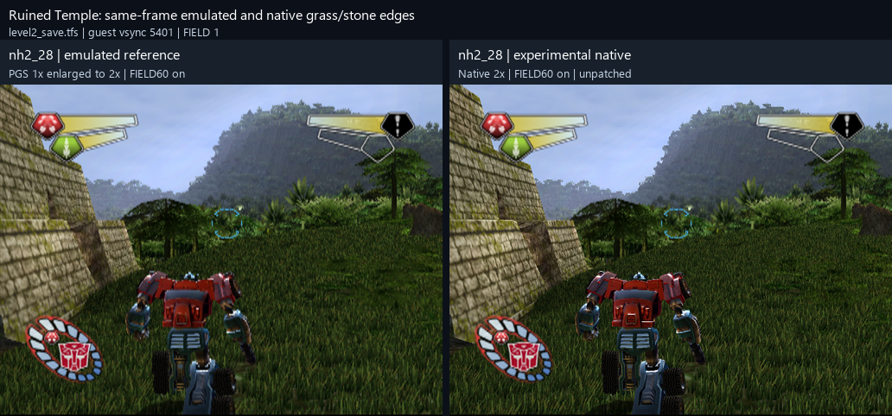

# Native renderer: experimental comparisons

The current emulated path uses parallel-gs. Native rendering rebuilds selected geometry into higher-resolution drawing, while maintaining geometry execution needed by later batches. It targets picture quality; it does not automatically remove CPU work.  These unpatched preview pairs are not final release screenshots.

## Costs and proposed device defaults

The calibrated desktop test system replay measured worst compact native 2x total at 6.901 ms versus baseline 8.5923 ms in the expensive temple window.  Grass alone measured 2.7284 ms compact versus 2.8795 ms baseline.  These are fixture costs, exclude shared work, and do not certify whole-game overhead. The desktop worst compact total was 3.501 ms using existing replay evidence, not a new desktop run. 

| Device | Proposed optional hires families | Status |
|---|---|---|
| Desktop RTX 4090  | 13b0, its chain, S1, S1b, W3  | Cheap-family subset proposed; combined production cost not measured |
| desktop test system RX 9070 XT  | Same subset | Replay-qualified proposal, not applied defaults |
| Legion Go 2 / 890M at 15 W  | No automatic 2x families  | Retain established base rendering/upscale; experimental opt-in |

Expensive families remain off for optional hires; W1/C1 captures are missing from this calibration.  Legion estimates in the model are conditional predictions, not handheld measurements. See [Performance](PERFORMANCE.md) for the native preparation bottleneck.

## Known picture differences and bugs

Visual inspection of all supplied comparison sheets found:

- Forest native pair: Optimus appears noticeably smaller/narrower in the native frame while HUD placement and scale match. This is a known apparent character-scale/geometry mismatch requiring investigation, not evidence of successful resolution scaling. Native foliage has sharper edges but different grass coverage and conspicuous tree/fern gaps. 
- Hub native pair: robot outlines are sharper, but surface highlights and panel shading differ; a dark hub panel remains a reported defect. No clear comparable overall robot-size reduction is visible in this cropped pair. 
- Temple native pair: robot surface shading/highlights, grass coverage and stone edges differ; the silhouette has local changes, but this sheet does not establish the forest's apparent overall size reduction. HUD remains aligned. 
- Across the emulated build sheets, scene framing and HUD broadly match. Robot highlights and fine edge detail vary slightly. Temple/HUD sheets use different FIELD60 settings, so they are not controlled renderer-quality A/B evidence. 

Foliage flicker and jagged transitions between base and hires rendering are reported bugs; still images cannot establish flicker behavior. Warp load-in black flicker also remained in v0.7.1 play.  Do not call these previews visually exact merely because offline family fixtures pass.

## Comparison gallery

These approved comparisons retain route/settings metadata from historical previews.

Autobot hub: Optimus, emblem and menu; v0.6.0 (PGS 1x | FIELD60 on), v0.7.1 (PGS 1x | FIELD60 on); level_mvp_cine.tfs, vsync 3972. 

Amazon spawn: grass, tree line and HUD; v0.6.0 (PGS 1x | FIELD60 on), v0.7.0 (PGS 1x | FIELD60 on), v0.7.1 (PGS 1x | FIELD60 on); level_mvp_cine.tfs, vsync 9004. 

Amazon arrival: cinematic forest canopy and distant horizon; v0.6.0 (PGS 1x | FIELD60 on), v0.7.0 (PGS 1x | FIELD60 on), v0.7.1 (PGS 1x | FIELD60 on); level_mvp_cine.tfs, vsync 5196. 

Ruined Temple spawn: stonework, distant foliage and grass; v0.6.0 (PGS 1x | FIELD60 off), v0.7.0 (PGS 1x | FIELD60 on), v0.7.1 (PGS 1x | FIELD60 on); level2_save.tfs, vsync 5332. 

HUD detail: health and Mini-Con display (identical crop); v0.6.0 (PGS 1x | FIELD60 off), v0.7.0 (PGS 1x | FIELD60 on), v0.7.1 (PGS 1x | FIELD60 on); level2_save.tfs, vsync 5332. 

Amazon forest: same-frame emulated and native foliage; nh2_28 | emulated reference (PGS 1x enlarged to 2x | FIELD60 on), nh2_28 | experimental native (Native 2x | FIELD60 on | unpatched); level_mvp_cine.tfs, vsync 9301, FIELD 1. 

Autobot hub: same-frame emulated and native panel lighting; nh2_28 | emulated reference (PGS 1x enlarged to 2x | FIELD60 on), nh2_28 | experimental native (Native 2x | FIELD60 on | unpatched); level_mvp_cine.tfs, vsync 3975, FIELD 1. 

Ruined Temple: same-frame emulated and native grass/stone edges; nh2_28 | emulated reference (PGS 1x enlarged to 2x | FIELD60 on), nh2_28 | experimental native (Native 2x | FIELD60 on | unpatched); level2_save.tfs, vsync 5401, FIELD 1. 

